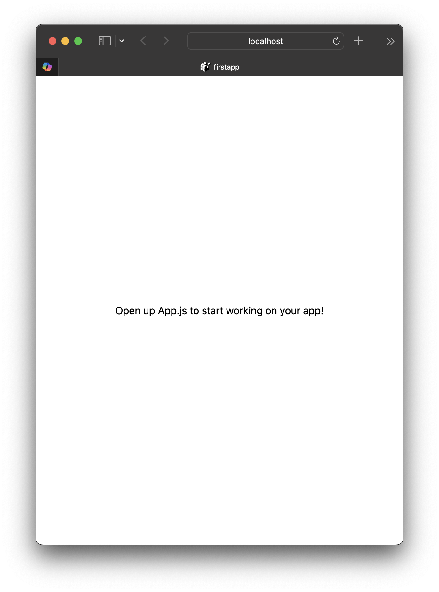

# React Native Lab Exercises 2
## Lab Exercises: Setting Up the Development Environment

**Lab goal**: By the end of this lab you should have a working development environment on your laptop:
- ✅ Node.js & NPM
- ✅ Expo (through `npx expo`)
- ✅ A first Expo project that runs in the browser and reloads automatically when you change the code
- ✅ A first look at JSX: `{}` expressions, conditional rendering, lists with `map` + `key`

You will use the same environment in all the following labs, so make sure every item in the [Checklist](#checklist) works before you leave.

---

## Exercise 1: Installing Node.js & NPM

<div class="exercise">

**Goal**: Install Node.js and verify NPM

**Steps**:
```bash
# 1. Install Node.js (LTS version)
### Official Installer (Recommended)
### - Download from [nodejs.org](https://nodejs.org/)
### - Choose the **LTS version** (Long Term Support)


# 2. Verification (in a NEW terminal after installing)
node --version    # You should see: v22.13 or newer (v24 LTS recommended)
npm --version     # You should see: 10.x.x or newer

# 3. Test the Node.js REPL
node
> console.log("Hello from Node.js!")
> .exit

# 4. Test NPM
npm help
```

</div>

**Note down**: The version numbers you see (you will need them if something doesn't work)

---

## Exercise 2: Node.js Basics & First Script

### Create your first Node.js script:

```bash
# 1. Create a directory for the lab
mkdir ~/ReactNativeLab
cd ~/ReactNativeLab

# 2. Create a test script
cat > hello.js << 'EOF'
// hello.js - First Node.js script
console.log("Hello from Node.js!");
console.log("Current directory:", __dirname);
console.log("Node version:", process.version);

const sum = (a, b) => a + b;
console.log("Sum of 5 + 3 =", sum(5, 3));
EOF

# 3. Run it
node hello.js
```

**Expected result**: You should see the corresponding messages in your terminal

---

## Exercise 3: NPM Package Management

<div class="exercise">

**Goal**: Understand NPM and create a `package.json`

**Steps**:
```bash
# 1. Create a new project directory
mkdir ~/ReactNativeLab/npm-test
cd ~/ReactNativeLab/npm-test

# 2. Initialize an NPM project
npm init -y

# 3. Look at package.json
cat package.json

# 4. Install a test package
##   N.B.: Since version 5, chalk is an ES Module (export default) and
##         does not work with require() as below — see Exercise 3b.
##         That is why we ask for version 4 specifically
npm install chalk@4

# 5. Create a script that uses the package
cat > app.js << 'EOF'
const chalk = require('chalk');
console.log(chalk.blue('Hello in blue!'));
console.log(chalk.red.bold('Error message in red!'));
EOF

# 6. Run it
node app.js
```

</div>

---

## Exercise 3b: Modules - CommonJS vs ES Modules

<div class="exercise">

**Goal**: Create your own modules and understand the two module systems of Node.js

**Steps**:
```bash
cd ~/ReactNativeLab/npm-test

# 1. CommonJS (require / module.exports)
cat > math.js << 'EOF'
module.exports = {
  add: (a, b) => a + b,
  subtract: (a, b) => a - b
};
EOF

cat > calc.js << 'EOF'
const math = require('./math');
console.log('5 + 3 =', math.add(5, 3));
EOF

node calc.js

# 2. ES Modules (import / export) - files with the .mjs extension
cat > math.mjs << 'EOF'
export const add = (a, b) => a + b;
export const subtract = (a, b) => a - b;
EOF

cat > calc.mjs << 'EOF'
import { add, subtract } from './math.mjs';
console.log('5 - 3 =', subtract(5, 3));
EOF

node calc.mjs

# 3. Newer chalk version (ES Module) with import
mkdir ~/ReactNativeLab/esm-test
cd ~/ReactNativeLab/esm-test
npm init -y
npm install chalk

cat > app.mjs << 'EOF'
import chalk from 'chalk';
console.log(chalk.green('Hello from an ES Module!'));
EOF

node app.mjs
```

</div>

**Questions**:
1. In `esm-test`, try an `app.js` with `const chalk = require('chalk')`. What error do you get, and why?
2. Which of the two systems does the `App.js` of the Expo project use (Exercise 7)?

<div class="tip">

Instead of `.mjs`, you can set `"type": "module"` in `package.json` — then every `.js` file in the project is an ES Module.

</div>

---

## Exercise 4: Understanding package.json

### Anatomy of package.json:
```json
{
  "name": "npm-test",           // Project name
  "version": "1.0.0",            // Semantic versioning
  "description": "",             // Project description
  "main": "index.js",            // Entry point
  "scripts": {                   // NPM scripts
    "test": "echo \"Error: no test specified\" && exit 1"
  },
  "keywords": [],                // Search keywords
  "author": "",                  // Your name
  "license": "ISC",              // License type
  "dependencies": {              // Production dependencies
    "chalk": "^4.1.2"
  }
}
```

<div class="tip">

**Versioning**: `^4.1.2` = compatible with 4.x.x (not 5.0.0)  
**node_modules/**: Contains the downloaded packages (do not commit it to a repo)

</div>

**Small task**: Add `"start": "node app.js"` to `scripts` and run `npm start`.

---

## Exercise 5: Creating your first Expo project

<div class="exercise">

**Goal**: Create a first Expo project

<div class="tip">

No global Expo installation is needed (the old `expo-cli` has been deprecated).
The Expo CLI comes with every project and is run with `npx expo ...`

</div>

**Steps**:
```bash
# 1. Create a new Expo project
  ##   N.B.: Use --template blank for a plain JavaScript project
  cd ~/ReactNativeLab
  npx create-expo-app@latest firstapp --template blank

# Creating an Expo project using the blank template.
# ✔ Downloaded and extracted project files.
# > npm install
#
# ✅ Your project is ready!
#
# To run your project, navigate to the directory and run one of the following npm commands.
#
# - cd firstapp
# - npm run android
# - npm run ios
# - npm run web

# 2. Enter the project
cd ~/ReactNativeLab/firstapp

# 3. Verification
npx expo --version

# 4. Look at the structure
ls -la
```

</div>

---

## Exercise 6: Theory - Expo Project Structure

### Structure of the Expo project:
```
firstapp/
├── .expo/                   # Local Expo files (created on the 1st start)
├── .git/                    # The project is already a git repository!
├── assets/                  # Images (icon, splash, favicon, Android icons)
│   ├── icon.png
│   ├── splash-icon.png
│   └── ...
├── node_modules/            # NPM dependencies
├── App.js                   # >>> Main component <<<
├── app.json                 # App configuration
├── index.js                 # Registers App as the root component
├── AGENTS.md                # Instructions for AI coding assistants
├── package.json             # Dependencies & scripts
└── package-lock.json        # Lock file for dependencies
```

**Main files**:
- `App.js`: The main component of the app
- `app.json`: Metadata (name, version, orientation, etc.)
- `package.json`: Scripts & dependencies

**Question**: Open `package.json`. Which scripts are there? Which versions of `expo`, `react` and `react-native` are used?

---

## Exercise 7: Examining & Understanding App.js

<div class="exercise">

**Goal**: Analyse the default Expo App.js

**Steps**:
```bash
# 1. Open App.js
cd ~/ReactNativeLab/firstapp
cat App.js
```

**Questions**:
1. Which components are used? 
2. Where is the styling defined? 
3. What is `export default`? 
4. How does the component return JSX? 

</div>

---

## Exercise 7b: Default App.js Analysis

```jsx
import { StatusBar } from 'expo-status-bar';
import { StyleSheet, Text, View } from 'react-native';

export default function App() {
  return (
    <View style={styles.container}>
      <Text>Open up App.js to start working on your app!</Text>
      <StatusBar style="auto" />
    </View>
  );
}

const styles = StyleSheet.create({
  container: {
    flex: 1,
    backgroundColor: '#fff',
    alignItems: 'center',
    justifyContent: 'center',
  },
});
```

**Component analysis**:
- `View`: Container (like `<div>` in HTML)
- `Text`: Text element (all text must be inside `<Text>`)
- `StyleSheet.create()`: Performance-optimised styles

---

## Exercise 8: Running the App

<div class="exercise">

**Goal**: Run the app in a browser (Expo web)

**Steps**:
```bash
# 1. Start the Expo development server
cd ~/ReactNativeLab/firstapp
npm start

# or
npx expo start

# 2. In the menu shown in the terminal:
#    Press 'w' for the web browser
#    (if asked to install react-dom / react-native-web, answer Yes,
#     or run: npx expo install react-dom react-native-web)

# 3. A browser window opens automatically
#    URL: http://localhost:8081

# 4. Observe:
#    - The text "Open up App.js to start working..."
#    - The layout (centered)
#    - The browser's development tools
```

</div>

**Expected result**:



---

## Exercise 8b: Expo Dev Tools

### When you run `npx expo start`, you see:

```
Starting Metro Bundler

› Metro waiting on exp://192.168.1.x:8081
› Scan the QR code above with Expo Go (Android) or the Camera app (iOS)

› Web is waiting on http://localhost:8081

› Press a │ open Android
› Press i │ open iOS simulator
› Press w │ open web

› Press r │ reload app
› Press m │ toggle menu
› Press j │ open debugger
```

**Browser Dev Tools** (F12 / Cmd+Option+I in the browser):
- 🧱 Elements: how `View`/`Text` become HTML elements
- 📊 Console: logs & errors from `console.log()`
- 🌐 Network: what the browser downloads from the Metro bundler

**Try it**: Add `console.log('App rendered');` inside the `App` function and find the message in the browser Console **and** in the terminal.

---

## Exercise 9: Modifying the App

<div class="exercise">

**Goal**: Change the default App.js and observe hot reloading

**Steps**:
```bash
# 1. Open App.js in an editor
code App.js  # or use another editor

# 2. Change the Text to:
<Text style={styles.title}>Welcome to React Native!</Text>
<Text style={styles.subtitle}>Mobile App Development Lab</Text>

# 3. Add styles for title and subtitle:
title: {
  fontSize: 24,
  fontWeight: 'bold',
  color: '#2c3e50',
  marginBottom: 10,
},
subtitle: {
  fontSize: 16,
  color: '#7f8c8d',
},

# 4. Save (Cmd+S / Ctrl+S)
# 5. Watch the browser reload automatically
```

</div>

---

## Exercise 9b: Complete Modified Code

```jsx
import { StatusBar } from 'expo-status-bar';
import { StyleSheet, Text, View } from 'react-native';

export default function App() {
  return (
    <View style={styles.container}>
      <Text style={styles.title}>Welcome to React Native!</Text>
      <Text style={styles.subtitle}>Mobile App Development Lab</Text>
      <StatusBar style="auto" />
    </View>
  );
}

const styles = StyleSheet.create({
  container: {
    flex: 1,
    backgroundColor: '#ecf0f1',
    alignItems: 'center',
    justifyContent: 'center',
  },
  title: {
    fontSize: 24,
    fontWeight: 'bold',
    color: '#2c3e50',
    marginBottom: 10,
  },
  subtitle: {
    fontSize: 16,
    color: '#7f8c8d',
  },
});
```

**Experiment** (with the server running):
1. Change the `backgroundColor` of `container` — does the browser update immediately?
2. Deliberately introduce a syntax error (e.g. delete a `>`) and save. What appears in the browser, and what in the terminal? Fix it.
3. Stop the server (`Ctrl+C`) and start it again. You will need to do this often!

---

## Exercise 10: JSX in Practice

<div class="exercise">

**Goal**: The basic JSX rules (see the slides): expressions in `{}`, conditional rendering, lists with `map` + `key`

**Steps**:
1. In `firstapp`, create the file `JsxDemo.js`:

```jsx
// JsxDemo.js
import { StyleSheet, Text, View } from 'react-native';

const student = { name: 'Eleni', semester: 5 };
const courses = ['Mobile Apps', 'Web Technologies', 'Databases'];
const getGreeting = (name) => `Hello, ${name}!`;

export default function JsxDemo() {
  const isSenior = student.semester >= 5;

  return (
    <View style={styles.box}>
      <Text style={styles.heading}>{getGreeting(student.name)}</Text>
      <Text>Semester: {student.semester}</Text>

      {isSenior && <Text style={styles.badge}>🎓 Advanced semester</Text>}

      <Text>
        {courses.length > 0 ? `Courses (${courses.length}):` : 'No courses'}
      </Text>
      {courses.map(course => (
        <Text key={course}>• {course}</Text>
      ))}
    </View>
  );
}

const styles = StyleSheet.create({
  box: { marginTop: 30, padding: 16, backgroundColor: 'white', borderRadius: 8 },
  heading: { fontSize: 18, fontWeight: 'bold', marginBottom: 6 },
  badge: { color: '#8e44ad', marginVertical: 6 },
});
```

2. In `App.js`, add `import JsxDemo from './JsxDemo';` and put `<JsxDemo />` below the subtitle

</div>

**Experiment** (with the server running) and explain what you see:
1. Change `semester` to `3` — what disappeared, and why?
2. Empty the `courses` array (`[]`) — which branch of the `? :` runs?
3. Remove `key={course}` — what warning appears in the Console?
4. Write `<div>Hello</div>` instead of `<Text>` — what error do you get on mobile/web?
5. Put text directly inside the `<View>` (without `<Text>`) — what happens?

<div class="tip">

In **Lab 03** we start from the `App.js` of Exercise 9b — `JsxDemo` can stay as a reference file.  
`{isSenior && ...}` is safe because `isSenior` is a boolean. With a number (e.g. `{count && ...}` when `count === 0`) the `0` would be displayed!

</div>

---

## Common Troubleshooting Issues

### Issue 1: "command not found: node" / "npm"
- Close and reopen the terminal after installing
- Windows: make sure the installer added Node.js to the `PATH`

### Issue 2: "command not found: expo"
```bash
# Solution: Use npx inside the project directory
cd ~/ReactNativeLab/firstapp
npx expo start
```

### Issue 3: `TypeError: chalk.blue is not a function` (or `ERR_REQUIRE_ESM` on older Node)
```bash
# Cause: a newer chalk (ES Module) was installed and you load it with require()
# Solution: install version 4 (see Exercise 3)
npm install chalk@4
# or use import in a .mjs file (see Exercise 3b)
```

### Issue 4: Metro bundler fails to start / "Unable to resolve module"
```bash
# Solution:
rm -rf node_modules package-lock.json
npm install
npx expo start --clear
```

### Issue 5: Port 8081 already in use
- Another Expo server is already running — stop it (`Ctrl+C` in the other terminal)
- or accept another port when Expo asks you

### Issue 6: Hot reload not working
```bash
# Solution:
# Press 'r' in terminal to reload manually
# or
npx expo start --clear
```

---

## Checklist

**Environment**:
- [ ] `node --version` and `npm --version` work
- [ ] `hello.js` and `app.js` (chalk) run
- [ ] The project `~/ReactNativeLab/firstapp` has been created
- [ ] `npx expo start` starts without errors

**Browser Testing**:
- [ ] App loads without errors (key `w`)
- [ ] All text displays correctly (including accented / non-Latin characters)
- [ ] Hot reload works (change in `App.js` → immediate update)
- [ ] You can see the `console.log()` output in the browser console
- [ ] `JsxDemo` is displayed and I can explain the 5 experiments of Exercise 10

➡️ In **Lab 03** we will continue in the same project (`firstapp`), adding interactivity (state, buttons, input), and run the app on a phone with Expo Go.

---
